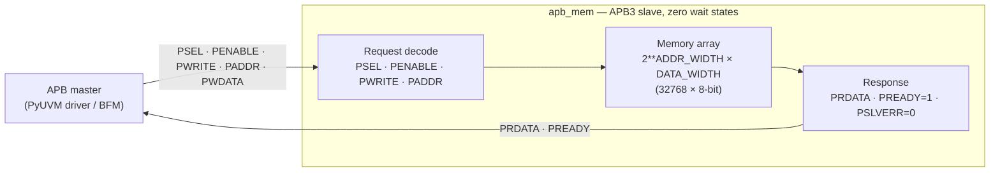

# apb_mem

APB byte-wide 32K memory RTL with a self-checking PyUVM testbench.

## Architecture

`apb_mem` is a zero-wait-state APB3 slave wrapping a byte-wide memory array
(`2**ADDR_WIDTH` locations of `DATA_WIDTH` bits; default 32768 × 8-bit = 32K).
`PREADY` is tied high so every transfer completes in the ACCESS phase, and
`PSLVERR` is tied low (the slave never errors). Writes are gated by `PRESETn`
so reset cannot corrupt the array, and the array powers up all-zero so reads of
un-written locations return 0.

| Parameter    | Default | Meaning                                   |
|--------------|---------|-------------------------------------------|
| `ADDR_WIDTH` | 15      | `2**15 = 32768` byte locations (32K)      |
| `DATA_WIDTH` | 8       | byte-wide data                            |

## Directory layout

- `rtl/` — the DUT (`apb_mem.sv`)
- `tb/` — PyUVM testbench and its cocotb runner (`tb/Makefile`)
- `Makefile` — standard DV gate targets (delegates the cocotb run to `tb/`)

The testbench is layered so only the BFM touches DUT signals:

| File                | Role                                                         |
|---------------------|--------------------------------------------------------------|
| `tb/apb_bfm.py`     | cocotb BFM: clock/reset, APB transfers, driver/monitor queues |
| `tb/apb_seq_item.py`| `ApbSeqItem` transaction (addr / data / write / rdata)       |
| `tb/apb_components.py` | driver, monitor, agent, scoreboard, env                   |
| `tb/apb_seq.py`     | sequences: write-read, random, walking edge cases            |
| `tb/apb_test.py`    | tests + the `@cocotb.test` entry points                      |

The **scoreboard** keeps a reference byte model and checks every read against the
last write to that address.

## Verification

Everything runs from the repo root and degrades gracefully if a tool is absent.

| Flow            | Command                | What it does                                                        |
|-----------------|------------------------|--------------------------------------------------------------------|
| Full regression | `make test`            | All three PyUVM tests (write-read, random, walking).               |
| Directed        | `make test-write-read` | Write a value, read it back from the same address.                |
| Random          | `make test-random`     | Constrained-random mix of reads and writes.                       |
| Walking         | `make test-walking`    | Directed first/last-address and all-0 / all-1 payload edge cases. |
| Waves           | `make waves`           | Full run dumping `tb/sim_build/apb_mem.fst` (open in GTKWave).    |
| Lint            | `make lint`            | `iverilog -Wall` compile check + Verilator RTL lint.              |
| Gate            | `make check`           | Lint then the full regression.                                    |
| CI              | `make regress` / `make ci` | Lint + regression as a single pass/fail gate.                 |

Run `make help` for the full target list.

## Toolchain

- Simulator: **Icarus Verilog 11** (`/usr/bin/iverilog`)
- Python: **`/usr/bin/python3`** (3.10) with **cocotb 1.9.2** + **pyuvm 4.0.1**

The cocotb runner (`tb/Makefile`) pins `ICARUS_BIN_DIR=/usr/bin` and the
cocotb-bound interpreter so the VPI is built against the same Python that imports
the testbench (avoids the OSS-CAD-Suite Python mismatch).
