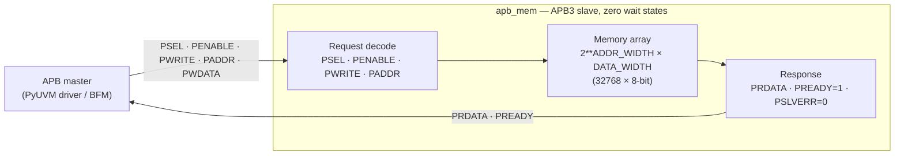
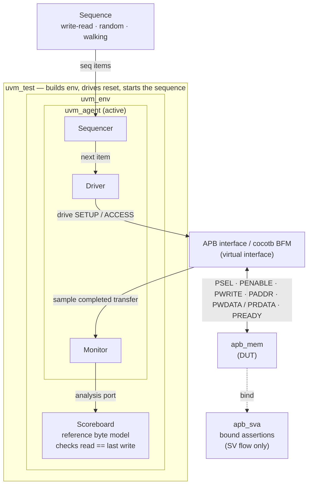

# apb_mem

[](https://github.com/markrthomas/uvm_review/actions/workflows/ci.yml)

APB byte-wide 32K memory RTL with a self-checking PyUVM testbench (runnable
here) and a mirror SystemVerilog UVM testbench (license-gated).

## Architecture

`apb_mem` is a zero-wait-state APB3 slave wrapping a byte-wide memory array
(`2**ADDR_WIDTH` locations of `DATA_WIDTH` bits; default 32768 × 8-bit = 32K).
`PREADY` is tied high so every transfer completes in the ACCESS phase, and
`PSLVERR` is tied low (the slave never errors). Writes are gated by `PRESETn`
so reset cannot corrupt the array, and the array powers up all-zero so reads of
un-written locations return 0.



| Parameter    | Default | Meaning                                   |
|--------------|---------|-------------------------------------------|
| `ADDR_WIDTH` | 15      | `2**15 = 32768` byte locations (32K)      |
| `DATA_WIDTH` | 8       | byte-wide data                            |

## Directory layout

- `rtl/` — the DUT (`apb_mem.sv`)
- `tb/` — PyUVM testbench and its cocotb runner (`tb/Makefile`)
- `uvm/` — SystemVerilog UVM testbench mirroring the PyUVM TB (`uvm/Makefile`)
- `sim/` — Verilator C++ coverage harness (`sim_main.cpp`)
- `Makefile` — standard DV gate targets (delegates the cocotb run to `tb/`)

The testbench is layered so only the BFM touches DUT signals:

| File                | Role                                                         |
|---------------------|--------------------------------------------------------------|
| `tb/apb_bfm.py`     | cocotb BFM: clock/reset, APB transfers, driver/monitor queues |
| `tb/apb_seq_item.py`| `ApbSeqItem` transaction (addr / data / write / rdata)       |
| `tb/apb_components.py` | driver, monitor, agent, scoreboard, env                   |
| `tb/apb_seq.py`     | sequences: write-read, random, walking edge cases            |
| `tb/apb_test.py`    | tests + the `@cocotb.test` entry points                      |

The **scoreboard** keeps a reference byte model and checks every read against the
last write to that address.

### SystemVerilog UVM testbench (`uvm/`)

`uvm/` is a native SystemVerilog UVM testbench that mirrors the PyUVM TB
component-for-component, as a reference deliverable. **This host has no
SystemVerilog/UVM simulator license**, so `make uvm` degrades gracefully — it
detects VCS / Xcelium / Questa and, finding none, prints a skip and exits 0. On
a licensed host it runs for real (`make uvm TEST=apb_random_test`).

It ships in two equivalent layouts: the multi-file set (default) and a single
self-contained file, `apb_tb_single.sv`, for drop-in use (e.g. EDA Playground).
Build the single-file variant with `make uvm SINGLE=1` (or `make single` inside
`uvm/`). The two share the same names — compile one or the other, never both.

An APB3 assertion checker, `uvm/apb_sva.sv` (a module `bind`-ed to every
`apb_mem` instance, inlined in the single-file variant), runs concurrently with
either layout. It covers the protocol (SETUP→ACCESS handshake, PENABLE
deassertion, address/data stability, no-X on active signals) and this slave's
tie-offs (zero-wait `PREADY`, never-error `PSLVERR`, bus-idle-during-reset),
plus `cover` points for the read and write transactions. It is scoped to the
UVM flow — the Icarus/cocotb simulator's SVA support is too weak to carry it.

| PyUVM (`tb/`)               | SystemVerilog UVM (`uvm/`)                       |
|-----------------------------|-------------------------------------------------|
| `apb_bfm.py` (cocotb BFM)   | `apb_if.sv` + driver/monitor virtual interface  |
| `ApbSeqItem`                | `apb_seq_item.sv`                               |
| `apb_seq.py` sequences      | `apb_sequences.sv`                             |
| driver / monitor / agent    | `apb_driver.sv` / `apb_monitor.sv` / `apb_agent.sv` |
| `ApbScoreboard`             | `apb_scoreboard.sv`                            |
| `ApbEnv`                    | `apb_env.sv`                                   |
| tests + `@cocotb.test`      | `apb_test.sv` + `apb_tb_top.sv` (`run_test`)   |

## Testbench block diagram

Both testbenches share the same UVM structure (the PyUVM and SystemVerilog
class names differ but map one-for-one per the table above). A sequence hands
transactions to the sequencer; the driver turns them into APB pin wiggles; the
monitor observes completed transfers and forwards them to the scoreboard, which
scores every read against a reference byte model. In the SV flow the `apb_sva`
checker is `bind`-ed onto the DUT and watches the same pins for protocol
violations.



## Verification

Everything runs from the repo root and degrades gracefully if a tool is absent.

| Flow            | Command                | What it does                                                        |
|-----------------|------------------------|--------------------------------------------------------------------|
| Full regression | `make test`            | All three PyUVM tests (write-read, random, walking).               |
| Directed        | `make test-write-read` | Write a value, read it back from the same address.                |
| Random          | `make test-random`     | Constrained-random mix of reads and writes.                       |
| Walking         | `make test-walking`    | Directed first/last-address and all-0 / all-1 payload edge cases. |
| Waves           | `make waves`           | Full run dumping `tb/sim_build/apb_mem.fst` (open in GTKWave).    |
| Lint            | `make lint`            | `iverilog -Wall` compile check + Verilator RTL lint.              |
| Coverage        | `make coverage`        | Verilator `--coverage` C++ harness → `sim/coverage.info` (lcov); fails below `COV_MIN` (default 100%). |
| Gate            | `make check`           | Lint then the full regression.                                    |
| CI              | `make ci`              | Lint + regression + coverage as a single pass/fail gate.          |
| SV UVM          | `make uvm`             | SystemVerilog UVM TB (VCS/Xcelium/Questa); skips cleanly if unlicensed. |

Run `make help` for the full target list.

## Tutorial

A step-by-step walk-through, from a clean checkout to extending the testbench.
Every command is run from the repo root unless noted.

### 1. Check the toolchain

The runnable flow needs Icarus Verilog and a Python with cocotb + pyuvm:

```bash
iverilog -V | head -1          # expect Icarus Verilog version 11.x
python3 -c "import cocotb, pyuvm; print(cocotb.__version__, pyuvm.__version__)"
```

If `python3` is missing the packages: `python3 -m pip install cocotb==1.9.2 pyuvm==4.0.1`.
Verilator is optional — it powers RTL lint and the coverage harness, and every
target that uses it degrades gracefully (prints a skip, exits 0) when it is
absent.

### 2. Run the whole regression

```bash
make test
```

This delegates to `tb/Makefile`, which compiles `rtl/apb_mem.sv` with Icarus and
runs all three cocotb tests. Expect three `PASS` lines and a zero exit code:

```
** TEST                          STATUS  SIM TIME (ns) ...
** apb_test.write_read_test      PASS   ...
** apb_test.random_test          PASS   ...
** apb_test.walking_test         PASS   ...
```

Each test builds the environment, pulses reset via the BFM, runs its sequence,
and the scoreboard asserts `errors == 0` in its check phase.

### 3. Run a single test

Pick one directed scenario while iterating:

```bash
make test-write-read     # write a byte, read it back from the same address
make test-random         # 64 constrained-random reads/writes
make test-walking        # first/last address × all-0 / all-1 / patterned data
```

Under the hood each sets `TESTCASE=<name>` for the cocotb runner.

### 4. Inspect waveforms

```bash
make waves               # runs the suite and writes tb/sim_build/apb_mem.fst
gtkwave tb/sim_build/apb_mem.fst
```

Look at `PSEL`/`PENABLE` to see the SETUP→ACCESS handshake and `PREADY` held
high (zero wait states).

### 5. Measure coverage

```bash
make coverage
```

This builds `rtl/apb_mem.sv` with Verilator `--coverage`, runs the C++ harness
in `sim/sim_main.cpp`, exports lcov to `sim/coverage.info`, and enforces a line
floor (`COV_MIN`, default 100). Lower the bar for a quick look with
`make coverage COV_MIN=90`.

### 6. Lint and the CI gate

```bash
make lint                # iverilog -Wall + Verilator RTL lint
make ci                  # lint + full regression + coverage, one pass/fail gate
```

`make ci` is the single command a CI job would run.

### 7. The SystemVerilog UVM testbench

```bash
make uvm                       # multi-file set, default write-read test
make uvm TEST=apb_random_test  # pick a test
make uvm SINGLE=1              # build the single-file variant instead
```

On this host (no UVM simulator licensed) `make uvm` prints a skip and exits 0.
On a licensed host it auto-detects VCS / Xcelium / Questa, elaborates the DUT +
interface + UVM package + the bound `apb_sva` checker, and runs
`+UVM_TESTNAME=<TEST>`.

**Run it on [EDA Playground](https://www.edaplayground.com)** — the single-file
variant is built for this. It has a free tier with UVM-capable simulators, so
you can run the SV/UVM TB without a local license:

1. **`design.sv` pane**: paste the contents of `uvm/apb_tb_single.sv` — this one
   file carries the interface, the UVM package (all components + tests), the top
   module `apb_tb_top` (which calls `run_test`), and the bound `apb_sva` checker.
   Do **not** also add the multi-file `uvm/*.sv` pieces; they define the same
   names and would clash.
2. **`testbench.sv` pane**: paste the contents of `rtl/apb_mem.sv` (the DUT).
   `apb_tb_top` instantiates it and the `bind` pulls the `apb_sva` checker in.

   Which pane holds which file does **not** affect the run — EDA Playground
   compiles both together (`vcs … design.sv testbench.sv`). Just keep them
   consistent with the tab names above.
3. In the left sidebar:
   - **Languages & Libraries → UVM/OVM**: tick **UVM 1.2**.
   - **Tools & Simulators**: pick a UVM-capable one — Aldec Riviera-Pro,
     Siemens Questa, Cadence Xcelium, or Synopsys VCS.
   - **Run options**: add **`+UVM_TESTNAME=apb_write_read_test`** — this is the
     reliable way to select the test (swap in `apb_random_test` or
     `apb_walking_test` for the others). The current `apb_tb_top` also defaults
     to the write-read test via `run_test("apb_write_read_test")`, so an
     up-to-date paste runs even with this box empty; setting it explicitly means
     you don't depend on the pasted file being current.
   - For waveforms: tick **Open EPWave after run** and add `+define+DUMP` to the
     compile options (the top's `` `ifdef DUMP `` guards a `$dumpvars`).
4. Click **Run**. A healthy log shows the UVM banner, `Running test
   apb_write_read_test...`, the scoreboard line `N reads checked, 0 errors`, no
   `UVM_ERROR`/`UVM_FATAL`, and `$finish` at a non-zero time.

> **Finishing at 0 ns?** EDA Playground's command line does **not** add
> `+UVM_TESTNAME`, so the test is chosen only by the `run_test(...)` call in
> `apb_tb_top`. A 0-ns finish that prints the UVM release-notes banner but **no**
> `Running test ...` line (and no `UVM_FATAL`) means `run_test` was reached with
> an empty test name — the pasted top is a stale copy calling `run_test();` with
> no argument. Fix it by adding `+UVM_TESTNAME=apb_write_read_test` to **Run
> options**, or re-copy the current `uvm/apb_tb_single.sv`, whose top ends with
> `run_test("apb_write_read_test");`. Also confirm **UVM 1.2** is ticked.

### 8. How a transaction flows

Tracing one write-then-read pair through the components (SV names; PyUVM mirrors
them):

1. **Sequence** (`apb_write_read_seq`) randomizes an `apb_seq_item` with
   `write == 1` under a constraint, then a second item with `write == 0` and
   `addr` constrained equal to the write's address.
2. **Sequencer → Driver**: the driver pulls each item and drives the APB SETUP
   phase (`PSEL=1, PENABLE=0`) then ACCESS (`PENABLE=1`), sampling `PRDATA` once
   `PREADY` is high; for reads it writes `PRDATA` back into the item.
3. **Monitor**: independently samples every completed ACCESS beat and publishes
   an `apb_seq_item` on its analysis port.
4. **Scoreboard**: on a write it updates `model[addr]`; on a read it compares
   `rdata` against `model[addr]` (default 0), counting mismatches and asserting
   none remain in the check phase.
5. **Assertions** (`apb_sva`, SV flow): concurrently check the pin-level
   protocol on every clock — independent of the scoreboard's data check.

### 9. Extend it

- **New stimulus**: add a `uvm_sequence` subclass in `uvm/apb_sequences.sv`
  (and/or `tb/apb_seq.py`), then a `uvm_test` that overrides `create_seq()` to
  launch it (Python: set `seq_cls`). Register the SV test with
  `` `uvm_component_utils `` so `+UVM_TESTNAME` can select it.
- **Resize the memory**: override the parameters, e.g.
  `make coverage` after changing `ADDR_WIDTH`/`DATA_WIDTH` defaults in
  `rtl/apb_mem.sv`; the interface, harness, and TBs pick the widths up.
- **New assertion**: add a property to `uvm/apb_sva.sv` (and mirror it in the
  inline copy inside `apb_tb_single.sv`).

## Toolchain

- Simulator: **Icarus Verilog 11** (`/usr/bin/iverilog`)
- Python: **`/usr/bin/python3`** (3.10) with **cocotb 1.9.2** + **pyuvm 4.0.1**

The cocotb runner (`tb/Makefile`) pins `ICARUS_BIN_DIR=/usr/bin` and the
cocotb-bound interpreter so the VPI is built against the same Python that imports
the testbench (avoids the OSS-CAD-Suite Python mismatch).
